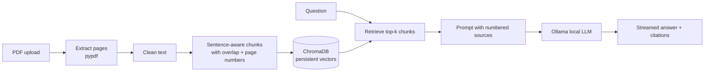

# AI Study Assistant

[](https://github.com/tina-yaghchian/ai-study-assistant/actions/workflows/ci.yml)


A study tool for lecture PDFs. Upload your notes, then ask questions about them, generate
structured study notes, or take a multiple-choice practice quiz. Answers are produced with
Retrieval-Augmented Generation (RAG) over a persistent vector index and cite the file and page
they come from. The language model runs locally through [Ollama](https://ollama.com), so
documents are never sent to an external API.

## Features

| | |
|---|---|
| **Chat with your lectures** | Ask questions in a chat interface. Answers stream in token by token and cite their sources as `[1]`, `[2]`; expand the sources panel to see the file, page number, match score and the exact passage. Follow-up questions keep the conversation context. |
| **Multi-document library** | Upload several PDFs at once. Each lecture is extracted, cleaned, chunked and embedded once, then persisted, so restarting the app does not re-process anything. Duplicate uploads are detected by content hash. Scope a question to specific lectures or search them all. |
| **Study notes** | Generates structured notes (overview, definitions, formulas in LaTeX, worked examples, exam tips, quick review) that represent the *whole* lecture, not just the first few pages. Add a focus topic to zoom in. Download as Markdown. |
| **Interactive quizzes** | Multiple-choice questions produced with structured JSON output, validated, and shuffled. Pick answers, check them, and get your score plus an explanation and page reference for every question. Choose question count, difficulty and topic. |
| **Model picker and health check** | The sidebar shows whether Ollama is reachable and lets you switch between any model you have installed. Clear, actionable errors when the server is down or a model is missing. |

## Architecture



**RAG pipeline in brief**

1. **Extraction.** Each PDF page is read with pypdf and cleaned: ligatures, dashes and broken
   characters are normalised, hyphenated line breaks are re-joined, and image credits are dropped.
   Page numbers are preserved so citations can point back to them.
2. **Chunking.** Text is split on sentence boundaries into ~1000-character chunks with ~150
   characters of overlap, so ideas that straddle a boundary remain retrievable. Over-long
   "sentences" such as tables are wrapped on word boundaries.
3. **Indexing.** Chunks are embedded and stored in a persistent ChromaDB collection (cosine
   distance) with `doc_id`, `filename` and `page` metadata.
4. **Retrieval and generation.** The top-k chunks are passed to the model as numbered sources.
   The system prompt requires the model to answer only from those sources, cite them inline, and
   say so when the notes do not contain the answer. Short follow-ups ("why?") are expanded with
   the previous question before retrieval.
5. **Notes and quizzes.** For long lectures every page gets a fair share of the context budget,
   or retrieval is used when a focus topic is given. Quizzes use Ollama's JSON-schema structured
   output and are validated before display.

## Project structure

```
ai-study-assistant/
├── app.py                     # Streamlit UI
├── study_assistant/
│   ├── config.py              # Settings from environment variables / .env
│   ├── documents.py           # PDF extraction and text cleaning
│   ├── chunking.py            # Sentence-aware, overlapping, page-tagged chunks
│   ├── store.py               # Document library + ChromaDB vector index
│   ├── llm.py                 # Ollama client: streaming, JSON output, error handling
│   ├── prompts.py             # Prompt templates and the quiz JSON schema
│   └── rag.py                 # Q&A, study notes and quiz generation
├── tests/                     # Pytest suite (runs offline, no model needed)
├── .streamlit/config.toml     # Theme and upload limits
└── .env.example               # All configurable settings
```

## Getting started

**Prerequisites:** Python 3.10+ and [Ollama](https://ollama.com/download).

```bash
# 1. Get the code
git clone https://github.com/tina-yaghchian/ai-study-assistant.git
cd ai-study-assistant

# 2. Create a virtual environment and install dependencies
python3 -m venv venv
source venv/bin/activate
pip install -r requirements.txt

# 3. Pull a model (any chat model works; qwen3:8b is the default)
ollama pull qwen3:8b

# 4. Run the app
python -m streamlit run app.py
```

Open http://localhost:8501, upload a lecture PDF from the sidebar, and start asking questions.

The first upload downloads a small embedding model (all-MiniLM-L6-v2, about 80 MB) used by
ChromaDB; after that everything works offline.

## Configuration

Copy `.env.example` to `.env` and change whatever you need. Every setting is optional.

| Variable | Default | Description |
|---|---|---|
| `OLLAMA_HOST` | `http://localhost:11434` | Where the Ollama server is running |
| `STUDY_MODEL` | `qwen3:8b` | Default model (can also be switched in the sidebar) |
| `STUDY_TEMPERATURE` | `0.3` | Sampling temperature |
| `STUDY_DATA_DIR` | `data` | Where the document library and vector index are stored |
| `STUDY_CHUNK_SIZE` | `1000` | Target chunk size in characters |
| `STUDY_CHUNK_OVERLAP` | `150` | Overlap between consecutive chunks |
| `STUDY_TOP_K` | `4` | Passages retrieved per question |
| `STUDY_MAX_CONTEXT_CHARS` | `12000` | Lecture text sent to the model for notes and quizzes |

## Testing

```bash
pip install -r requirements-dev.txt
pytest
ruff check .
```

The test suite covers text cleaning, PDF extraction (using PDFs generated on the fly), chunking
and overlap, the vector store and scoped search, prompt construction with numbered sources,
reasoning-tag filtering for streamed output, quiz validation and answer shuffling, and settings
validation. It uses a deterministic offline embedding function and a fake model, so it runs in
under a second without Ollama. GitHub Actions runs it on every push.

## Design decisions

- **Local inference.** Students' notes can be personal or copyrighted; keeping inference on
  device avoids sending them to a third-party API and costs nothing to run.
- **Persistent index keyed by content hash.** Embedding is the slowest step, so each file is
  processed exactly once and survives restarts.
- **Citations are first-class.** Retrieved passages are numbered in the prompt and shown in the UI,
  which makes answers verifiable and discourages hallucination.
- **Structured output for quizzes.** A JSON schema plus defensive parsing is more reliable
  than asking the model to format a quiz as free text.

## Roadmap

- OCR for scanned PDFs
- Hybrid retrieval (BM25 + vectors) and re-ranking
- Spaced-repetition flashcards from generated notes
- Support for PowerPoint and Word lecture files
